# Metehan Ulusoy — Kişisel Portfolyo

**Canlı site:** https://metehanulusoy.github.io  
**GitHub deposu:** https://github.com/metehanulusoy/metehanulusoy.github.io

CEN303 Web Mobil Programlama dersinin final projesi. Hiçbir çatı ya da kütüphane kullanılmadan, yalnızca HTML, CSS ve JavaScript ile yazılmış; çok sayfalı, duyarlı (telefon, tablet, masaüstü) ve Türkçe/İngilizce iki dilli bir kişisel portfolyo sitesi.

## Sitenin amacı

Kim olduğumu, neler üzerinde çalıştığımı ve yaptığım projeleri tek bir yerde göstermek. Ziyaretçi projeler arasında arama yapabilir, GitHub'daki güncel depolarımı görebilir ve bana kolayca yazabilir. İçerik (projeler, hakkımda yazısı, zaman çizelgesi, iletişim bilgileri) Next.js ile yazdığım önceki portfolyomdan alındı; bu site, onun çatısız ve sıfırdan yazılmış bir sürümüdür.

## Sayfalar

| Sayfa | Dosya | İçerik |
| --- | --- | --- |
| Ana sayfa | `index.html` | Kısa tanıtım, neler yaptığım (dört alan), `data/projects.json` dosyasından gelen üç öne çıkan proje ve iletişim çağrısı |
| Hakkımda | `about.html` | Hakkımda yazısı, kısa bilgiler, ay ay zaman çizelgesi ve kullandığım araçlar |
| Projeler | `projects.html` | 23 projelik liste (arama, kategori süzgeci, favoriler) ve GitHub API'den gelen canlı depo listesi (dil süzgeci) |
| İletişim | `contact.html` | İletişim kanalları ve doğrulamalı iletişim formu |
| 404 | `404.html` | GitHub Pages'in bulunamayan adresler için gösterdiği sayfa |

## Öne çıkan özellikler

- **İki dil:** Sağ üstteki TR/EN düğmesi sayfadaki bütün metinleri değiştirir; tercih `localStorage` içinde saklanır.
- **Koyu ve açık tema:** İlk açılışta işletim sisteminin tercihine uyar, düğmeyle değiştirilebilir; tercih `localStorage` içinde saklanır.
- **Projelerde arama ve süzme:** Türkçe karakterden bağımsız arama ("arşiv", "arsiv" ve "ARŞİV" aynı sonucu verir), kategori düğmeleri, yıldızla favorilere ekleme ve "yalnız favoriler" süzgeci.
- **GitHub'dan canlı liste:** Depolar sayfa açılırken GitHub API'den çekilir. Yükleniyor ve hata durumları ekranda gösterilir, hata olursa "Tekrar dene" düğmesi çıkar. Saatlik istek sınırına takılmamak için yanıt 10 dakika `sessionStorage` içinde tutulur.
- **İletişim formu:** JavaScript ile doğrulama, her alanın hemen altında kendi hata mesajı, yazdıkça kaydedilen taslak (`localStorage`, 24 saat sonra silinir) ve başarı mesajı. Sitenin sunucusu olmadığı için geçerli mesaj, ziyaretçinin e-posta uygulamasında gönderilmeye hazır hâlde açılır (`mailto:`); e-posta uygulaması olmayan bilgisayarlar için "Metni kopyala" düğmesi vardır.
- **Erişilebilirlik:** "İçeriğe geç" bağlantısı, klavyeyle tam kullanım, görünür odak çerçevesi, `aria-expanded`, `aria-pressed` ve `aria-invalid` nitelikleri, ayrıca "azaltılmış hareket" tercihine uyan animasyonlar.

## Gereksinimler ve karşılandıkları yerler

| Katman | Gereksinim | Nerede |
| --- | --- | --- |
| HTML | En az 3 ayrı sayfa | [`index.html`](index.html), [`about.html`](about.html), [`projects.html`](projects.html), [`contact.html`](contact.html) (ayrıca `404.html`) |
| HTML | Tüm sayfalarda ortak gezinme menüsü | [`index.html`, 35. satır](index.html#L35); [`about.html`, 28. satır](about.html#L28); [`projects.html`, 31. satır](projects.html#L31); [`contact.html`, 29. satır](contact.html#L29) |
| HTML | Anlamsal etiketler: `header`, `nav`, `main`, `section`, `footer` | [`index.html`, 29. satır](index.html#L29), [`index.html`, 35. satır](index.html#L35), [`index.html`, 58. satır](index.html#L58), [`index.html`, 59. satır](index.html#L59), [`index.html`, 122. satır](index.html#L122) |
| HTML | Anlamsal etiketler: `article` | [`about.html`, 94. satır](about.html#L94); proje kartları da `article`: [`js/project-cards.js`, 81. satır](js/project-cards.js#L81) |
| HTML | `meta viewport` | [`index.html`, 5. satır](index.html#L5); [`about.html`, 5. satır](about.html#L5); [`projects.html`, 5. satır](projects.html#L5); [`contact.html`, 5. satır](contact.html#L5) |
| HTML | Doğrulama nitelikli form (`required`, `type="email"`, `minlength`) | [`contact.html`, 98. satır](contact.html#L98), [`contact.html`, 103. satır](contact.html#L103), [`contact.html`, 122. satır](contact.html#L122) |
| HTML | Görsellerde anlamlı alt metni | statik görsel [`about.html`, 150. satır](about.html#L150); kart görsellerinin metinleri [`data/projects.json`, 27. satır](data/projects.json#L27), görsele yazılması [`js/project-cards.js`, 93. satır](js/project-cards.js#L93) |
| CSS | Tek bir harici stil dosyası | [`css/style.css`](css/style.css); bağlantı [`index.html`, 18. satır](index.html#L18) |
| CSS | Flexbox | [`css/style.css`, 110. satır](css/style.css#L110) |
| CSS | CSS Grid | [`css/style.css`, 779. satır](css/style.css#L779), [`css/style.css`, 1749. satır](css/style.css#L1749) |
| CSS | En az iki kırılma noktası (telefon, tablet, masaüstü) | [`css/style.css`, 1709. satır](css/style.css#L1709) (tablet), [`css/style.css`, 459. satır](css/style.css#L459) (menü), [`css/style.css`, 1732. satır](css/style.css#L1732) (masaüstü) |
| CSS | Mobilde açılıp kapanan menü | CSS [`css/style.css`, 351. satır](css/style.css#L351); düğme [`index.html`, 49. satır](index.html#L49); JS [`js/main.js`, 51. satır](js/main.js#L51) |
| CSS | CSS değişkenleri (`:root`) | [`css/style.css`, 20. satır](css/style.css#L20); koyu tema [`css/style.css`, 74. satır](css/style.css#L74) |
| CSS | Geçiş (transition) ve animasyon | [`css/style.css`, 117. satır](css/style.css#L117), [`css/style.css`, 1659. satır](css/style.css#L1659) |
| CSS | `:hover` ve `:focus` durumları | [`css/style.css`, 533. satır](css/style.css#L533), [`css/style.css`, 1453. satır](css/style.css#L1453), [`css/style.css`, 171. satır](css/style.css#L171) |
| JS: DOM | Harici `.js` dosyaları, satır içi olay yok | [`index.html`, 21. satır](index.html#L21); HTML'de hiç `onclick` ya da `<script>` bloğu yok |
| JS: DOM | `addEventListener` ile en az 3 farklı olay | click [`js/main.js`, 59. satır](js/main.js#L59), input [`js/projects.js`, 90. satır](js/projects.js#L90), submit [`js/contact.js`, 169. satır](js/contact.js#L169), change [`js/projects.js`, 103. satır](js/projects.js#L103), keydown [`js/main.js`, 68. satır](js/main.js#L68), scroll [`js/main.js`, 113. satır](js/main.js#L113) |
| JS: DOM | JSON verisinden `createElement` ile dinamik öğeler | [`js/helpers.js`, 10. satır](js/helpers.js#L10), kart [`js/project-cards.js`, 80. satır](js/project-cards.js#L80), depo satırı [`js/projects.js`, 279. satır](js/projects.js#L279) |
| JS: DOM | Arama ve filtreleme | [`js/projects.js`, 55. satır](js/projects.js#L55), arama [`js/projects.js`, 90. satır](js/projects.js#L90), dil süzgeci [`js/projects.js`, 208. satır](js/projects.js#L208) |
| JS: DOM | `classList` ile görünüm değiştirme | karanlık mod [`js/theme.js`, 58. satır](js/theme.js#L58), menü [`js/main.js`, 51. satır](js/main.js#L51) |
| JS: veri | `fetch` + `async/await` (proje içindeki JSON) | [`js/project-cards.js`, 16. satır](js/project-cards.js#L16), [`js/project-cards.js`, 17. satır](js/project-cards.js#L17) |
| JS: veri | `fetch` + `async/await` (herkese açık API) | [`js/projects.js`, 221. satır](js/projects.js#L221), [`js/projects.js`, 225. satır](js/projects.js#L225) |
| JS: veri | Yükleniyor ve hata durumları ekranda | [`js/helpers.js`, 42. satır](js/helpers.js#L42); yükleniyor [`js/projects.js`, 162. satır](js/projects.js#L162); hata [`js/projects.js`, 173. satır](js/projects.js#L173) |
| JS: veri | `localStorage` ile bilgi saklama | tema [`js/theme.js`, 27. satır](js/theme.js#L27), dil [`js/i18n.js`, 326. satır](js/i18n.js#L326), favoriler [`js/project-cards.js`, 57. satır](js/project-cards.js#L57), form taslağı [`js/contact.js`, 106. satır](js/contact.js#L106) |
| JS: form | Gönderimde JS ile doğrulama (`preventDefault`) | [`js/contact.js`, 170. satır](js/contact.js#L170), kurallar [`js/contact.js`, 44. satır](js/contact.js#L44) |
| JS: form | Hata mesajı ilgili alanın yanında | [`contact.html`, 99. satır](contact.html#L99), [`js/contact.js`, 70. satır](js/contact.js#L70) |
| JS: form | Başarılı gönderimde geri bildirim | [`contact.html`, 137. satır](contact.html#L137), [`js/contact.js`, 186. satır](js/contact.js#L186) |
| Güvenlik | Kullanıcı girdisi `textContent` ile yazılır | [`js/contact.js`, 183. satır](js/contact.js#L183); projede `innerHTML` hiç kullanılmadı |
| Güvenlik | API anahtarı yok | GitHub API anahtarsız kullanılıyor: [`js/projects.js`, 11. satır](js/projects.js#L11) |
| Güvenlik | Ek: içerik güvenlik politikası (CSP) | [`index.html`, 6. satır](index.html#L6) |
| Kod yönetimi | Düzenli klasör yapısı | `css/`, `js/`, `img/`, `data/`, `fonts/` |

## Kullanılan API

- **GitHub REST API:** `GET https://api.github.com/users/metehanulusoy/repos` ([`js/projects.js`](js/projects.js)). Ücretsiz ve herkese açıktır, anahtar gerektirmez. Anahtarsız kullanımda saatte 60 istek sınırı olduğu için yanıt 10 dakika `sessionStorage` içinde tutulur; sınır aşılırsa ekranda açıklayıcı bir hata mesajı çıkar.
- **Proje içi veri:** `data/projects.json` de aynı şekilde `fetch` ve `async/await` ile okunur ([`js/project-cards.js`](js/project-cards.js)).

## Klasör yapısı

```
.
├── index.html, about.html, projects.html, contact.html, 404.html
├── css/
│   └── style.css            Tek stil dosyası
├── js/
│   ├── theme.js             Koyu/açık tema
│   ├── i18n.js              Türkçe/İngilizce metinler ve dil düğmesi
│   ├── main.js              Mobil menü, kaydırma efektleri, alt bilgideki yıl
│   ├── helpers.js           Ortak yardımcılar: güvenli öğe oluşturma, yükleniyor/hata kutusu
│   ├── project-cards.js     Proje verisi, kartlar ve favoriler
│   ├── home.js              Ana sayfadaki öne çıkan projeler
│   ├── projects.js          Arama, süzme ve GitHub depo listesi
│   └── contact.js           İletişim formu
├── data/
│   └── projects.json        Proje verisi (Türkçe ve İngilizce)
├── img/                     Favicon, proje görselleri, README ekran görüntüleri
└── fonts/                   Göktürkçe işaret için yazı tipi ve lisansı
```

## Yerelde çalıştırma

`data/projects.json` dosyası `fetch` ile okunduğu için `index.html` dosyasını çift tıklayarak açmak yerine yerel bir sunucu kullanın; örneğin VS Code'un Live Server eklentisi ya da proje klasöründe `python3 -m http.server` komutu. Sayfa yine de doğrudan dosyadan açılırsa, proje kutusunda bunu açıklayan bir mesaj çıkar.

- `404.html` içindeki yollar site kökünden başlar (`/css/style.css` gibi), çünkü GitHub Pages bu sayfayı iç içe hatalı adreslerde de gösterir. Bu yüzden 404 sayfası yalnızca site kökünden sunulduğunda (GitHub Pages ya da proje klasöründe çalışan yerel sunucu) doğru görünür.
- GitHub listesinin yükleniyor ve hata durumlarını denemek için: liste 10 dakika `sessionStorage`'da tutulduğu için yeni bir sekme açın, sonra tarayıcının geliştirici araçlarında Network sekmesinden ağı kapatıp (Offline) sayfayı yenileyin. Hata mesajı ve "Tekrar dene" düğmesi görünür.

## Ekran görüntüleri

| Sayfa | Masaüstü | Telefon |
| --- | --- | --- |
| Ana sayfa | 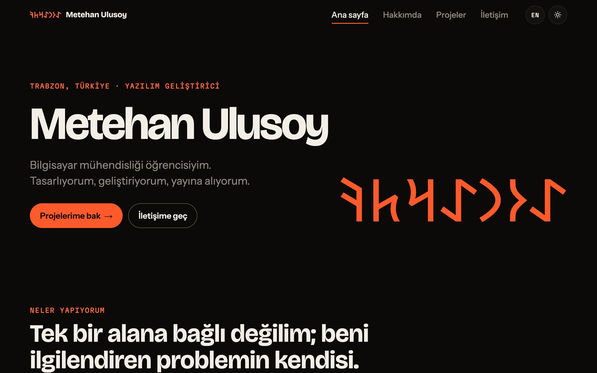 | 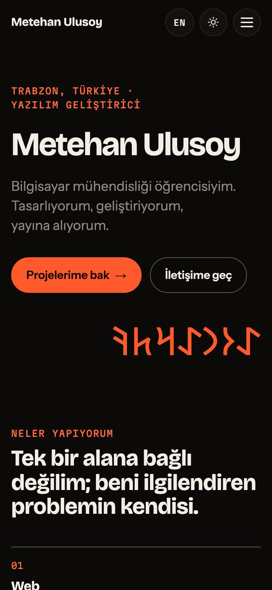 |
| Hakkımda | 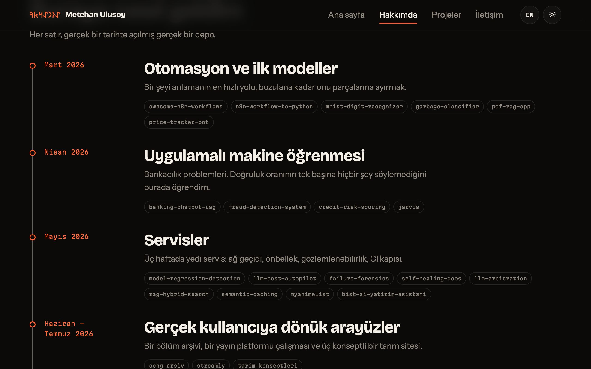 | 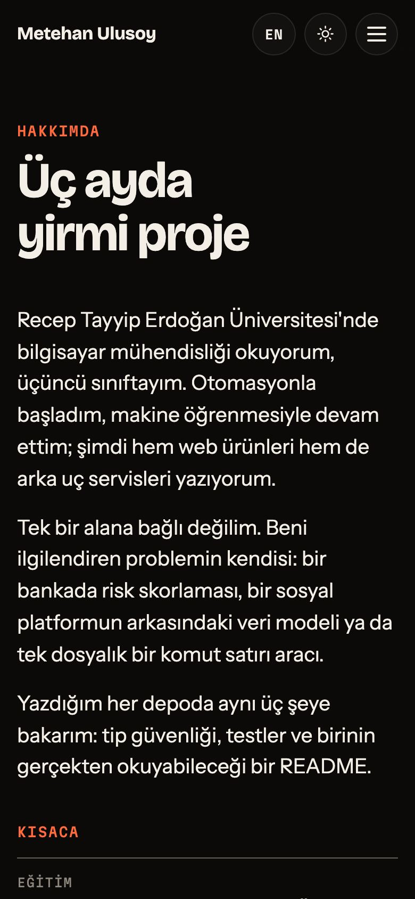 |
| Projeler | 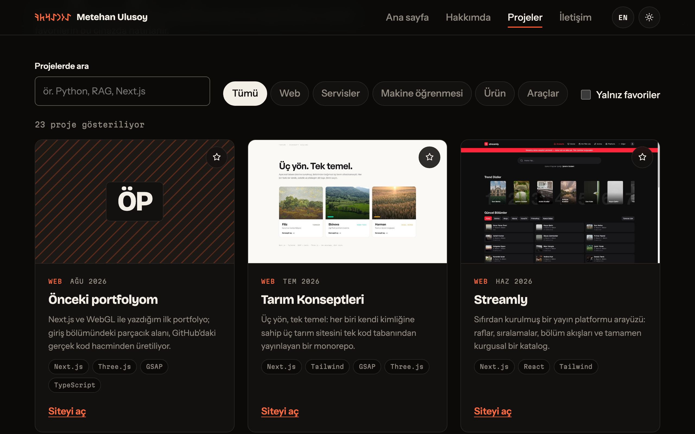 | 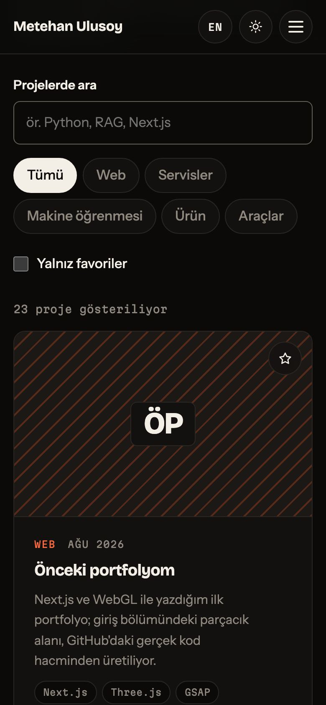 |
| GitHub listesi | 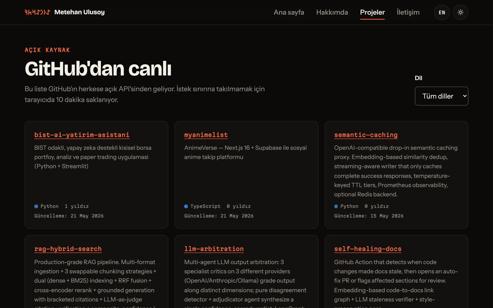 | 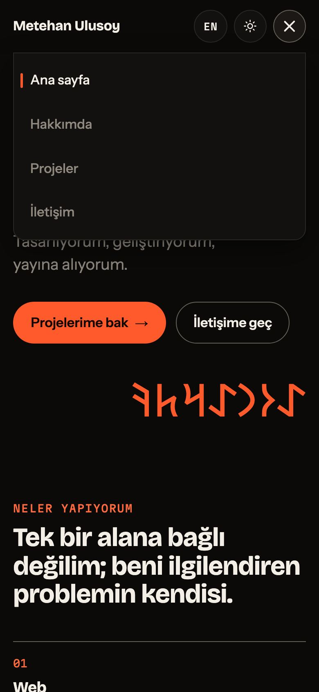 |
| İletişim (boş gönderimde hata mesajları) | 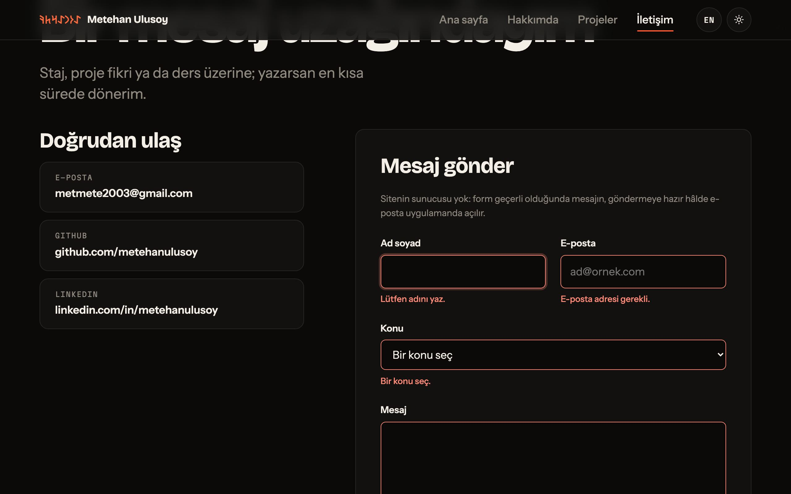 | 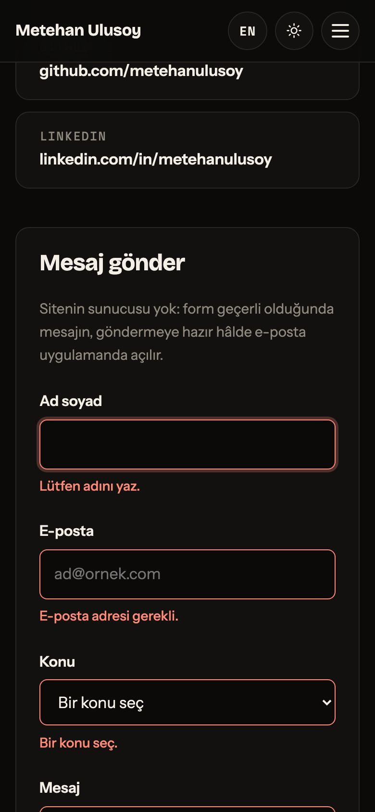 |
| Açık tema, İngilizce | 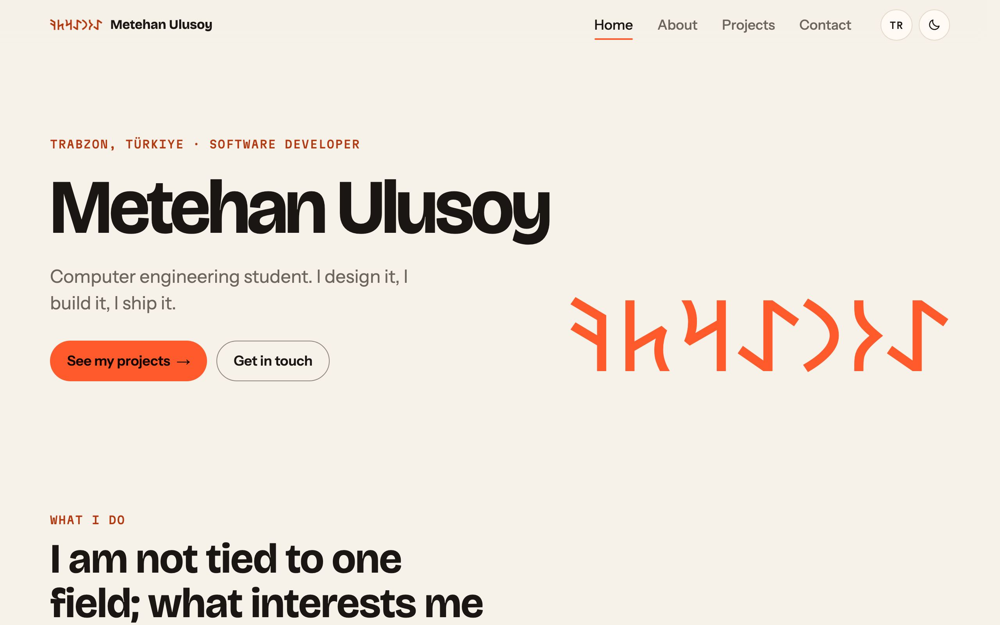 | 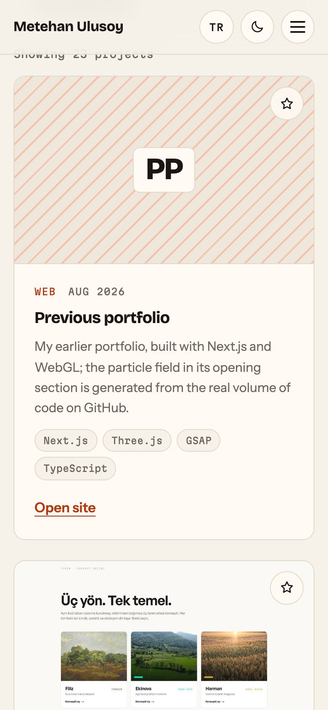 |

## Yapay zekâ kullanımı

Ödev yönergesinin istediği gibi belirtiyorum: Bu projede Anthropic'in **Claude** adlı yapay zekâ asistanından yararlandım.

- **Nerede:** Sayfaların HTML iskeleti, `css/style.css` ve `js/` klasöründeki JavaScript kodu Claude ile birlikte yazıldı. Proje açıklamalarının Türkçe ve İngilizce hâlleri, bu README'deki gereksinim tablosu ve ekran görüntüleri de onun yardımıyla hazırlandı.
- **Nasıl:** Konuyu, sayfa yapısını, özellikleri (TR/EN düğmesi, karanlık mod, GitHub API, iletişim formu) ve yayın yöntemini (GitHub Pages) ben belirledim; Claude kodu bu kararlara göre yazdı ve tarayıcıda test etti. Sitedeki bilgiler (projelerim, hakkımda yazısı, iletişim bilgilerim) kendi önceki portfolyomdan alındı.
- Kodun nasıl çalıştığı, dosyaların içindeki yorum satırlarında açıklanmıştır.

## Kaynaklar ve lisanslar

- Site içeriği: kendi önceki portfolyom (https://metehan-portfolio.vercel.app).
- Yazı tipleri: Google Fonts üzerinden Bricolage Grotesque, Instrument Sans ve Martian Mono; Göktürkçe işaret için Noto Sans Old Turkic (SIL Open Font License 1.1, [`fonts/OFL.txt`](fonts/OFL.txt)).
- İkonlar: elle çizilmiş satır içi SVG'ler.
- Kod: MIT lisansı ([`LICENSE`](LICENSE)).
